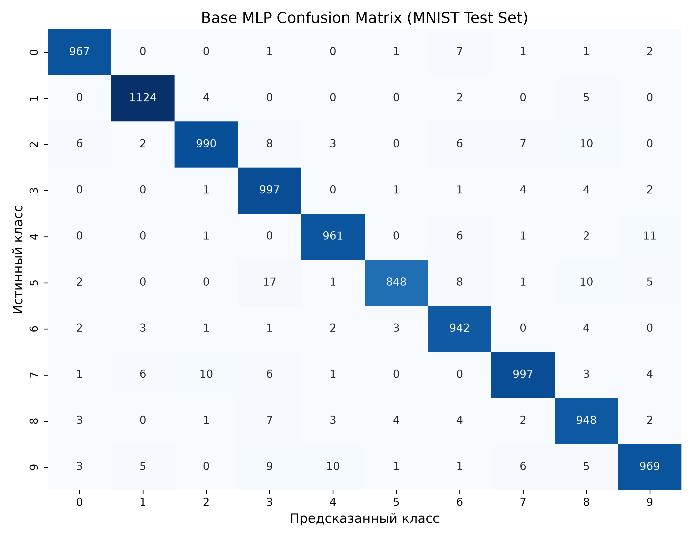
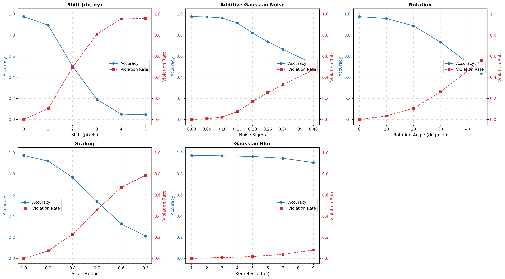
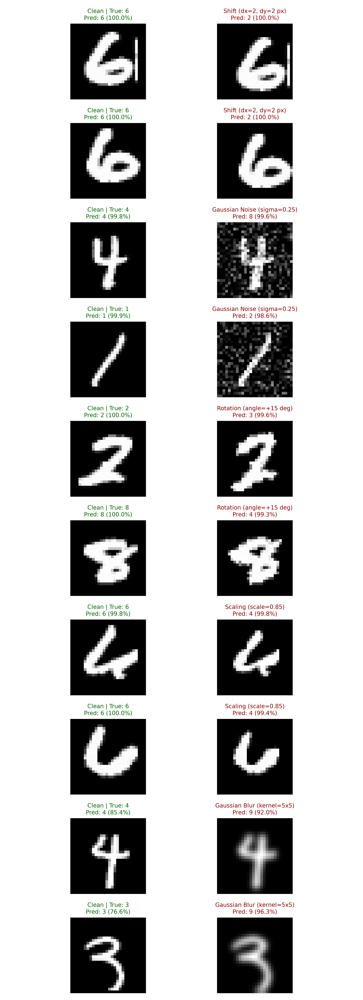
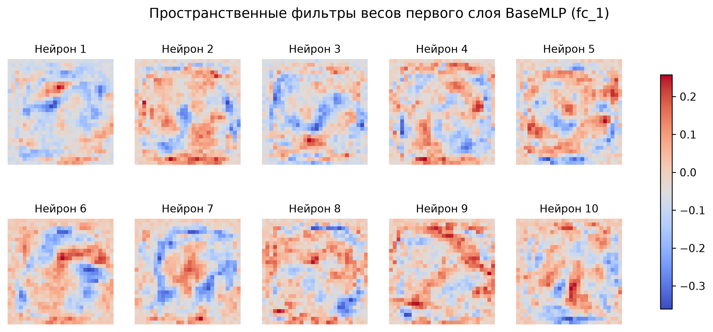
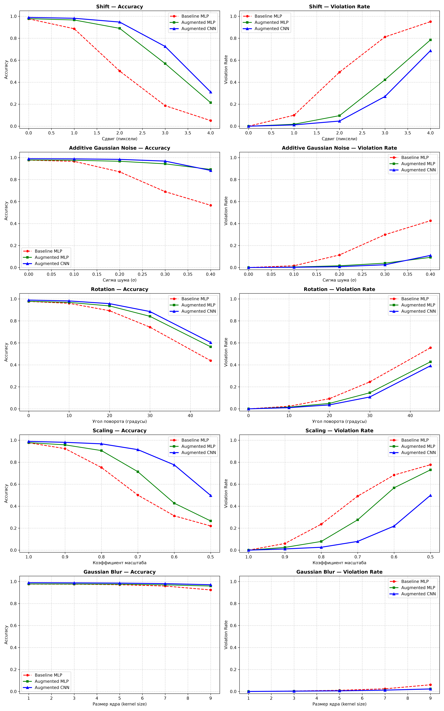

# Исследование устойчивости классификатора изображений методом метаморфического тестирования

## 1. Контекст и суть метаморфического тестирования
В реальных системах машинного обучения классификаторам часто доверяют на основании единственной метрики — точности (accuracy) на отложенной выборке. Однако модель с тестовой точностью >97% может оставаться хрупкой: опираться на поверхностные признаки и непредсказуемо менять предсказания при незначительных изменениях входа.
Главная сложность при тестировании модели на новых данных — **проблема оракула**: отсутствие истинной разметки для вновь сгенерированных примеров.
Один из способов выявлять дефекты без разметки — **метаморфическое тестирование**. Метод проверяет согласованность поведения модели относительно известных **метаморфических отношений**, не используя при этом никак истинную разметку:
> *Если ко входу $X$ применить преобразование $T$, сохраняющее семантическую категорию объекта, то предсказание модели $f(T(X))$ обязано быть эквивалентным $f(X)$; в задаче классификации: $f(T(X)) = f(X)$.*

Несоответствие $f(T(X)) \neq f(X)$ фиксируется как **нарушение оракула**. 

**Источники:** 
1. *Kexin Pei, Yinzhi Cao, Junfeng Yang, Suman Jana: **DeepXplore: Automated Whitebox Testing of Deep Learning Systems** https://arxiv.org/pdf/1705.06640*
2. *T.Y. Chen, S.C. Cheung, S.M. Yiu: **Metamorphic Testing: A New Approach for Generating Next Test Cases** https://arxiv.org/pdf/2002.12543*

## 2. Воспроизводимость и запуск
### Структура репозитория
```text
├── data/                         # Датасет MNIST (офлайн .gz файлы)
├── results/                      # Артефакты экспериментов
│   ├── base_mlp.pt               # Чекпоинт Baseline MLP
│   ├── augmented_mlp.pt          # Чекпоинт Augmented MLP
│   ├── base_cnn.pt               # Чекпоинт Сверточной модели (BaseCNN)
│   ├── base_cm.png               # Матрица ошибок Baseline
│   ├── mlp_weights.png           # Визуализация весов первого слоя BaseMLP (XAI)
│   ├── curves.png                # Кривые деградации Baseline
│   ├── comparison_curves.png     # Сравнительные кривые моделей (Base vs Aug)
│   ├── comparison_all_models.png # Сравнительные кривые всех трех моделей
│   └── violations/
│       └── top_10_violations.png # Топ-10 контрастных нарушений
├── fuzzer.py                     # Модуль метаморфического фаззера
├── notebook.ipynb                # Экспериментальный ноутбук полного цикла
├── requirements.txt              # Зафиксированные зависимости
└── README.md                     # Отчет по проекту
```

Основное исследование проходит внутри *notebook.ipynb* с целью последовательной демонстрации выявления проблематики и ее решения. Фаззер вынесен в файл *fuzzer.py* - как независимая компонента исследования.
Для воспроизведения исследования достаточно последовательно запустить все ячейки ноутбука, начиная с первой. С целью воспроизводимости результатов используется фиксация сидов через *set_seed(42)*.

## 3. Датасет и используемые модели

Для исследования был выбран набор данных *MNIST* - как набор данных, на котором возможно обучить простую модель за приемлемое время обучения на ЦПУ распознавать классы цифр с высокой эффективностью.
В качестве основной модели исследования была спроектирована простая полносвязная нейросеть *BaseMLP*:

**Flatten() -> Linear(28 * 28, 128) -> ReLU() -> Linear(128, 10)** 

Также в конце исследования была предложена простая сверточная нейросеть с целью улучшения результата *BaseCNN*:

**Conv(1, 16, kernel_size=5, padding=2) -> ReLU() -> MaxPool2d(2,2) -> Flatten() -> Linear(16 * 14 * 14, 128) -> ReLU() -> Linear(128, 10)**

Обе модели обучались в течение 5 эпох. Размер батча - 64 изображения. Оптимизатор - Adam(lr=1e-3). Функция потерь - кроссэнтропия

## 4. Граничные условия и список преобразований

Было реализовано 5 преобразований, сохраняющих инвариантность метки:

1. **Сдвиг** ($\Delta x, \Delta y \le 4$ px): строгий предел обусловлен размером рамки цифр в MNIST, предотвращающий обрезание краев изображения.
2. **Аддитивный гауссов шум** ($\sigma \in [0.0, 0.4]$): моделирует фоновые сенсорные помехи.
3. **Поворот** ($\alpha \le 45^\circ$): ограничение защищает от геометрического искажения, при котором символ начинает напоминать другую категорию (например, переворот «6» в «9»).
4. **Масштабирование** ($\text{scale} \ge 0.5$): предотвращает чрезмерное уменьшение, сохраняя читаемость штрихов.
5. **Гауссово размытие** (kernel size до $9 \times 9$): имитирует расфокусировку оптической системы.

## 5. Основные метрики baseline

Оценка BaseMLP на тестовом наборе:
```text
Test Accuracy:        0.9743
Macro-Precision:      0.9744
Macro-Recall:         0.9740
Macro-F1 Score:       0.9741
```
Усреднение Macro было выбрано в связи с сбалансированностью выборки датасета MNIST.



## 6. Оценка устойчивости модели

Для оценки устойчивости реализован модуль `fuzzer.py`, выполняющий детерминированный перебор параметров искажений при фиксированном `seed=42`. 

Перед этапом фаззинга выполнена валидация таксономии ошибок: через визуализацию весов первого слоя (`results/mlp_weights.png`) эмпирически доказано, что нейроны MLP выучивают статические пространственные фильтры, привязанные к центру кадра. Это объясняет высокую уязвимость полносвязных сетей к пространственным сдвигам ($dx, dy$).

По результам фаззинга получены кривые деградации качества для исходной модели:



## 7. Анализ ошибок

Приведем примеры наиболее интересных ошибок модели, полученных по результатам фаззинга:



Можно видеть, что в этих примерах модель с высокой уверенностью предсказывает правильный класс на исходном изображении, но при искажении начинает с высокой уверенностью выдавать ошибочный класс.

## 8. Таксономия ошибок

На основе анализа и выявленных нарушений дефекты модели сгруппированы в 3 группы:
1. **Пространственная зависимость**: в исходном датасете все цифры находятся в центре изображения. Нейросеть научилась внимательно смотреть только на центр, при этом не учитывая остальную часть изображения, что приводит к ошибкам при сдвиге цифры или ее повороте.



2. **Неустойчивость к шуму**: на исходном датасете пиксели в которых нет части, относящейся к цифре являются строго черными. При добавлении шума, часть таких пикселей становятся промежуточного цвета, что ошибочно интерпретируется нейросетью, как часть цифры.
3. **Неустойчивость к масштабированию**: при изменении размера цифры нейросеть может перестать видеть в определенной части изображения определенные части цифры, по которым она ранее ее распознавала, что приводит к ошибке

## 9. Улучшение устойчивости модели. Сравнительный анализ предложенных подходов

В ходе исследования предложено 2 подхода по улучшению устойчивости модели:
1. **Обучение исходной модели на аугментированных данных**: предлагается обучать модель на аугментированных данных, закладывая еще на этапе обучения возможность отделять шум от реальных частей цифры, устойчивость к пространственным смещениям и т.д.
2. **Использовать вместо полносвязной нейросети простую сверточную**: предполагается, что сверточный слой, проходя по всему изображению сможет повысить устойчивость модели к пространственным сдвигам, доверять значению не определенного пикселя (который может быть выбросом), а значению пикселей определенной части изображения.

По результатам обучения новых моделей на тестовом наборе данных получены следующие метрики:

Метрики качества на чистом тесте:
```text
Модель\Метрика        BaseMLP       AugmentedMLP        BaseCNN
Test Accuracy:        0.9743        0.9753              0.9897
Macro-Precision:      0.9744        0.9755              0.9897
Macro-Recall:         0.9740        0.9750              0.9896
Macro-F1 Score:       0.9741        0.9752              0.9896
```

Можно видеть, что в результате предложенных изменений модели только улучшили свое качество на тестовой выборке.

Рассмотрим теперь устойчивость каждой модели при фаззинге (тестирование проводилось на одинаково преобразованных данных с фиксированными сидами):



По графикам видно, что после предложенных улучшений модели стали гораздо более устойчивыми при фаззинге. Теперь значимая потеря качества происходит при экстремальных значениях параметров преобразований (например, при сдвиге на 4 пикселя). 
В большинстве случаев сверточная нейросеть показывает наилучшую устойчивость, незначительно проигрывая AugmentedMLP только на аддитивном гауссовом шуме (это связано со спецификой MaxPool2d, который в качестве максимального пикселя может взять сильно искаженный).
В целом по результатам исследования мы смогли предложить 2 устойчивых варианта, значимо превосходящих по фаззингу искомую модель.

## 10. Используемые инструменты

* **Фреймворки и библиотеки:**
  * `PyTorch` — построение, обучение и инференс нейросетевых моделей.
  * `Torchvision` - автоматическая загрузка набора данных MNIST и базовая тензорная предобработка.
  * `Albumentations` и `OpenCV` — конвейер аугментаций данных и реализация метаморфических трансформаций.
  * `Scikit-learn` — расчет macro-метрик и построение матрицы ошибок.
  * `Matplotlib` и `Seaborn` — визуализация кривых деградации, матриц ошибок и сравнительных характеристик.
  * `NumPy` — для работы с векторами меток. Так же массивы numpy используются в работе библиотеки `Albumentations`

* **ИИ-ассистенты:**
LLM (Gemini) - проектирование формата визуализации результатов; проверка; валидация и предложение к исправлению неточностей в коде; рекомендация литературы к теме исследования.
***


